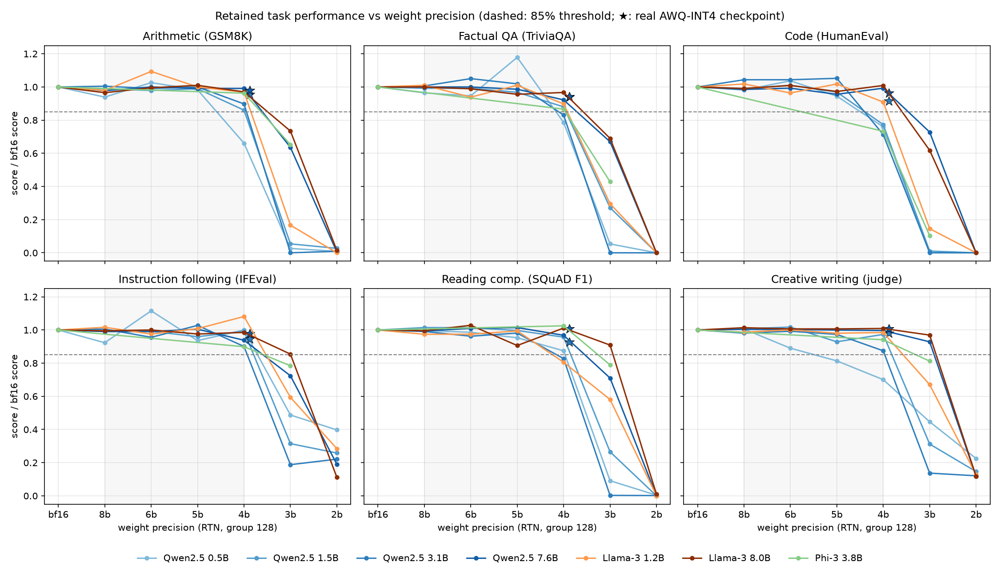
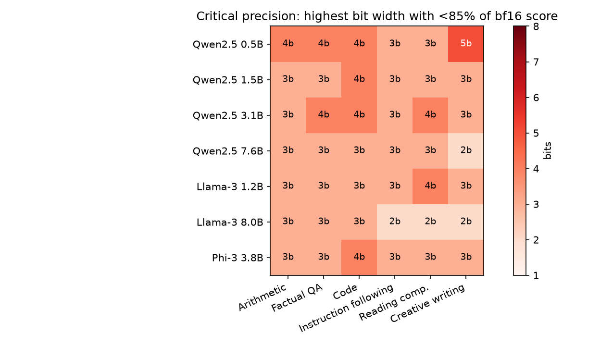
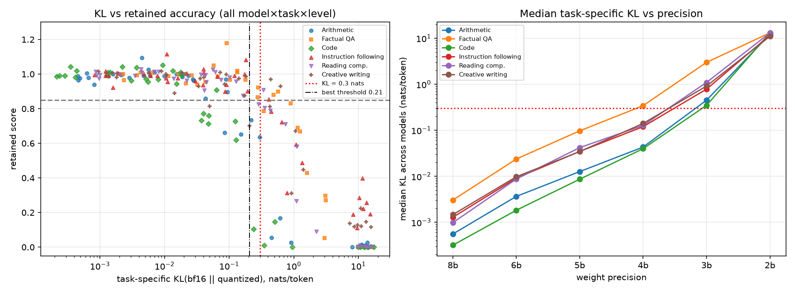

# Quantization Failure Modes: Task-Specific Accuracy Cliffs in Weight-Reduced Language Models

## 1. Executive Summary

**Question.** When the weights of an instruction-tuned LLM are quantized to fewer bits, which task types lose accuracy first? Does accuracy fall off a "cliff"? Do smaller models fail at higher precision? And does KL divergence from the full-precision model warn of the cliff before accuracy degrades?

**Answer.** We tested 7 models from 3 families (Qwen2.5 0.5/1.5/3/7B, Llama-3.2-1B and Llama-3.1-8B, Phi-3-mini 3.8B). Each was quantized with weight-only round-to-nearest (RTN, group size 128) at bf16, 8, 6, 5, 4, 3 and 2 bits and scored on six task types. Measured that way, **the accuracy cliff for every task lies at or below 4→3 bits, not between INT8 and INT4.** 8 and 6 bits are essentially lossless (3 small significant drops in 72 paired model×task tests). 5 bits is nearly so (4/36). At 4 bits the average loss is modest but task-dependent: about 3% for instruction following, 16% for code. At 3 bits most models lose 50–100% on every task.

The pre-registered hypothesis is mostly **not supported** in its specific form:
- Arithmetic and factual QA are sensitive but not the most sensitive; **code generation** is.
- Only 1/7 models (arithmetic) and 2/7 (factual QA) show a >15% INT8→INT4 cliff.
- Reading comprehension and creative writing are robust at INT4 for most models, but not for the smallest ones.
- Size helps (Spearman ρ = −0.53 between log size and critical precision, p = 0.0003). For 7–8B models the steepest drop moves down to 3→2 bits. But the effect is not monotonic: Qwen2.5-3B was the *least* robust Qwen model at 3 bits.
- Task-specific KL separates broken from healthy configurations very well (AUC 0.97; best threshold 0.21 nats, 95% CI 0.12–0.34, consistent with the hypothesized ~0.3). However, it is a **concurrent rather than leading** indicator: at the last precision before a cliff, KL exceeded 0.3 in only 6/42 cases.

**Practical implications.**
1. Group-128 INT6/8 is safe for all six task types, and INT5 nearly so.
2. INT4 needs task-specific validation, especially for code and especially for ≤3B models; AWQ recovers most of the RTN-INT4 loss.
3. INT3 RTN is unusable below 7B.
4. Aggregate accuracy masks substantial answer churn: 9–17% of items flip correct→wrong at 5 bits, offset by a similar number of wrong→correct flips. INT4 errors are fluent and confident, so they are hard to detect downstream.

## 2. Research Question & Motivation

**Hypothesis (as given).**
- H1: Arithmetic reasoning and factual QA are the most quantization-sensitive tasks, with a cliff (>15% drop) between INT8 and INT4.
- H2: Creative writing and reading comprehension are robust down to INT4.
- H3: Smaller models in a family hit the cliff at higher precision than larger ones.
- H4: KL divergence from the full-precision model predicts cliff onset (threshold ≈ 0.3 nats) before accuracy visibly degrades.

**Why it matters.** Weight quantization is the default deployment path for open LLMs, yet bit widths are usually chosen from perplexity or a single multiple-choice benchmark. Uneven, task-specific damage, and especially silent damage, matters most to people deploying models for code, math or factual assistance.

**Gap.** GPTQ (Frantar et al., 2022) and AWQ (Lin et al., 2024) report perplexity and a few zero-shot multiple-choice tasks at 3–4 bits. Later evaluation studies (e.g. Li et al., 2024, "Evaluating Quantized LLMs"; Dutta et al., 2024, "Accuracy is Not All You Need") show uneven degradation and argue for distributional metrics and "flips". To our knowledge, none combine all of the following:
- a fine bit-width sweep (8/6/5/4/3/2) that can *locate* the cliff,
- generative tasks (code, IFEval, creative writing) alongside QA,
- an explicit test of KL as a *leading* indicator with a numeric threshold.

No literature review was pre-gathered for this run, so this positioning is from prior knowledge rather than a systematic search.

## 3. Experimental Setup

### Models
All models are bf16 HF checkpoints run locally; no API models were involved, since quantization requires weight access. The original idea suggested Ollama; we used vLLM + HF instead because it allows arbitrary bit widths with one code path.

| key | checkpoint | family | params |
|---|---|---|---|
| qwen0.5b | Qwen/Qwen2.5-0.5B-Instruct | Qwen2.5 | 0.49B |
| qwen1.5b | Qwen/Qwen2.5-1.5B-Instruct | Qwen2.5 | 1.54B |
| qwen3b | Qwen/Qwen2.5-3B-Instruct | Qwen2.5 | 3.09B |
| qwen7b | Qwen/Qwen2.5-7B-Instruct | Qwen2.5 | 7.62B |
| llama1b | unsloth/Llama-3.2-1B-Instruct (mirror of meta-llama) | Llama-3 | 1.24B |
| llama8b | unsloth/Meta-Llama-3.1-8B-Instruct (mirror) | Llama-3 | 8.03B |
| phi3mini | microsoft/Phi-3-mini-4k-instruct | Phi-3 | 3.82B |
| *-awq | Qwen/Qwen2.5-{3B,7B}-Instruct-AWQ (official INT4, g128) | Qwen2.5 | reference |

### Quantization (`src/quant.py`)
- **Method:** weight-only, asymmetric min–max RTN with group size 128 along the input dimension, applied to every linear layer inside the transformer blocks (q/k/v/o, gate/up/down). Embeddings and the LM head stay in bf16, as in GPTQ/AWQ evaluations.
- **Fake quantization:** weights are rounded to the 2^b-level grid and de-quantized back to bf16. This is numerically what an INT-b g128 kernel computes. Unit tests confirm ≤2^b distinct values per group.
- **Implementation in vLLM:** quantization is done in place inside the vLLM worker, from a CPU copy of the original weights, between precision levels. Prefix caching is disabled.
- **Tensor parallelism:** used when GPU memory was fragmented. We assert that every shard's input dimension stays divisible by 128, so groups match the unsharded layout.
- **RTN rationale:** RTN needs no calibration data (no calibration-set confound) and is a pessimistic lower bound. AWQ-INT4 checkpoints show what a production quantizer achieves.
- **Robustness (Exp. 4):** per-output-channel RTN (no grouping) at 8/6/5/4/3 bits for Qwen2.5-1.5B and Llama-3.2-1B.

### Tasks (`src/prepare_data.py`, seed 42; 1,614 prompts)

| task type | dataset | n | prompt | metric |
|---|---|---|---|---|
| Arithmetic reasoning | GSM8K test | 250 | zero-shot CoT, "The answer is N" | exact numeric match |
| Factual QA | TriviaQA rc.nocontext val | 400 | closed-book short answer | normalized alias match |
| Reading comprehension | SQuAD v1.1 val | 400 | passage + question, extract span | token F1 (EM also stored) |
| Code generation | HumanEval (all) | 164 | complete function in a code block | pass@1, sandboxed execution |
| Instruction following | IFEval (random 300/541) | 300 | raw prompt | prompt-level strict accuracy (Google checker) |
| Creative writing | Reddit WritingPrompts test | 100 | "~200-word story" | LLM judge: mean of fluency, coherence, relevance, creativity (1–10) / 10 |

Decoding was greedy (temperature 0, seed 0), using each model's chat template. `max_tokens` was 512 (GSM8K, HumanEval), 32 (QA), 768 (IFEval) and 400 (stories). The creative-writing judge was **Qwen3-8B-AWQ** (thinking off, greedy). It was blind to model and precision, and produced 0 parse failures over all judgments. The rubric prompt is in `src/judge.py`.

### Divergence metrics (`src/kl.py`, HF transformers)
- **Task-specific KL:** for each model and task, the first 60 items' bf16 greedy responses (≤256 tokens) are teacher-forced through each quantized model. KL(bf16‖quantized) is averaged over response tokens, using bf16 top-128 log-probs plus a lumped tail bucket. This is a lower bound on exact KL; checked against exact KL it is within ~1% (e.g. 0.3624 vs 0.3661, 0.0929 vs 0.0932).
- **Also recorded:** top-1 agreement and the NLL of the bf16 tokens.
- **WikiText-2 test perplexity:** 32 × 1024-token windows.

### Statistics
- 95% bootstrap CIs (1,000 resamples) for scores.
- Paired McNemar tests (binary tasks) or Wilcoxon tests (F1 and judge scores), bf16 vs each level, with Benjamini–Hochberg FDR correction over all 160 tests.
- Friedman test for task differences across models.
- Spearman correlation for size vs critical precision.
- For KL: ROC-AUC, a Youden-optimal threshold with bootstrap CI, an out-of-sample check on the per-channel runs, and a lead-time analysis.

**Pre-registered definitions** (planning.md):
- retained = score_b / score_bf16;
- *cliff* = retained drops by >0.15 between adjacent tested precisions;
- *critical bits* = highest precision with retained < 0.85.

### Compute
- **Hardware:** 4× RTX A6000 48 GB, shared with other users. Typically only 2–6 GB was free per GPU, so models ran in 4–20 GB slices, often with `--enforce-eager` and occasionally tensor-parallel.
- **Software:** vLLM 0.32.0, torch 2.13, transformers 5.19, Python 3.12.
- **Volume:** ≈9.8M generated tokens. Per-level generation time was ~1–2 min for 0.5–1.5B models, ~8 min for 7–8B on a 20 GB slice, and 13–33 min for Phi-3/Qwen-3B on a busy shared GPU.
- **Cost:** no API cost.

### Deviations from plan (time and GPU constraints)
- **Partial sweeps:** Phi-3-mini ran at bf16/4/3 bits only (its bf16 pass took 33 min on a contended GPU). Every other model has all 7 levels.
- **Skipped:** Qwen2.5-14B bf16 never fit in available memory.
- Every analysis uses only the levels actually run, and adjacent-level cliffs are computed over the tested levels.

## 4. Results

All numbers below are produced by `src/analyze.py` / `src/make_tables.py`; the complete set is in `results/tables.md`.

*Figure 1. Score relative to bf16 for each task. Lines show RTN group-128 per model; ★ marks official AWQ-INT4 checkpoints. The dashed line is 0.85 retained. The grey band spans INT8→INT4.*

### 4.1 Where is the cliff? (H1, H2)

**Table B. Mean retained fraction across models (RTN g128)**

| task | 8b | 6b | 5b | 4b | 3b | 2b |
|---|---|---|---|---|---|---|
| arithmetic (GSM8K) | 0.98 | 1.01 | 1.00 | 0.90 | 0.32 | 0.01 |
| factual QA (TriviaQA) | 1.00 | 0.99 | 1.02 | 0.88 | 0.34 | 0.00 |
| code (HumanEval) | 1.00 | 1.01 | 0.99 | **0.84** | 0.23 | 0.00 |
| instruction following (IFEval) | 0.99 | 1.00 | 0.99 | 0.97 | 0.56 | 0.24* |
| reading comprehension (SQuAD F1) | 0.99 | 1.00 | 0.97 | 0.92 | 0.48 | 0.00 |
| creative writing (judge) | 1.00 | 0.99 | 0.95 | 0.93 | 0.61 | 0.14 |

\*IFEval has a non-zero floor: garbage output trivially satisfies some constraints (e.g. "no commas", "all lowercase").

**Table D. Models with a significant drop vs bf16 (BH q < 0.05) / models tested at that level**

| task | 8b | 6b | 5b | 4b | 3b | 2b |
|---|---|---|---|---|---|---|
| arith | 0/6 | 0/6 | 0/6 | 3/7 | 7/7 | 6/6 |
| code | 0/6 | 0/6 | 0/6 | 3/7 | 7/7 | 6/6 |
| creative | 0/6 | 1/6 | 2/6 | 3/7 | 7/7 | 6/6 |
| factqa | 0/6 | 0/6 | 1/6 | 3/7 | 7/7 | 6/6 |
| instr | 0/6 | 0/6 | 0/6 | 0/7 | 7/7 | 6/6 |
| reading | 1/6 | 1/6 | 1/6 | 5/7 | 7/7 | 6/6 |

**Table C. Critical bits** (highest precision with retained < 0.85; "1" = never below 0.85 at any tested level)

| model | arith | factqa | code | instr | reading | creative |
|---|---|---|---|---|---|---|
| Qwen2.5-0.5B | 4 | 4 | 4 | 3 | 3 | **5** |
| Llama-3.2-1B | 3 | 3 | 3 | 3 | 4 | 3 |
| Qwen2.5-1.5B | 3 | 3 | 4 | 3 | 3 | 3 |
| Qwen2.5-3B | 3 | 4 | 4 | 3 | 4 | 3 |
| Phi-3-mini 3.8B | 3 | 3 | 4 | 3 | 3 | 3 |
| Qwen2.5-7B | 3 | 3 | 3 | 3 | 3 | 2 |
| Llama-3.1-8B | 3 | 3 | 3 | 2 | 2 | 2 |

*Figure 2. Critical precision per model and task (darker = fails at higher precision).*

**Findings.**
- **For models ≤3.8B the steepest drop is 4→3 bits** (largest-drop step = 4→3 in 28/30 cells; the two exceptions are Llama-1B creative and reading). **For the 7–8B models it is 3→2 bits in all 12 cells.**
- **The pre-registered INT8→INT4 cliff (>15% retained drop) is rare** (6 models with both levels): 1/6 on arithmetic (Qwen-0.5B), 2/6 on factual QA, 3/6 on code, 2/6 on reading, 1/6 on creative and 0/6 on instruction following.
- **H1 is therefore not supported as stated.** Arithmetic and factual QA are among the more INT4-sensitive tasks (mean retained 0.90 and 0.88, with significant drops in 3/7 models each), but **code generation is the most INT4-sensitive** (mean 0.84; retained 0.71–0.77 for 4/7 models: Qwen-0.5B/1.5B/3B and Phi-3). The INT4 task ranking itself is not significant (Friedman p = 0.11).
- **At 3 bits the ranking is clear** (Friedman p = 1e-4). Code collapses hardest (mean retained 0.23), then arithmetic (0.32), factual QA (0.34) and reading (0.48). IFEval (0.56) and creative writing (0.61) degrade least.
- **H2 is partially supported.** Reading comprehension keeps ≥0.85 F1 at INT4 for 5/7 models (Llama-1B 0.81 and Qwen-3B 0.83 dip just below), yet SQuAD is the task with the *most* statistically significant INT4 drops (5/7) — small but consistent. Creative writing is robust at INT4 for 1.2B+ models (0.87–1.01 retained), but **Qwen-0.5B's stories degrade gradually from 6 bits** (0.89 → 0.81 → 0.70). This is the only case of a cliff above 4 bits.
- **AWQ-INT4 recovers most of the RTN-INT4 loss** (Qwen-3B code 0.71 → 0.91; arithmetic 0.90 → 0.95; factual QA 0.83 → 0.94). With a production quantizer, INT4 is close to lossless for ≥3B models.

### 4.2 What do quantization errors look like? (error analysis)

**Table E (excerpt). Answer flips vs bf16, pooled over models**

| task / bits | correct in bf16 | lost (→wrong) | gained (→right) | share of losses that are fluent wrong answers |
|---|---|---|---|---|
| arith 8b | 1040 | 63 (6%) | 41 | 0.86 |
| arith 5b | 1040 | 112 (11%) | 108 | 0.93 |
| arith 4b | 1253 | 211 (17%) | 105 | 0.90 |
| arith 3b | 1253 | 827 (66%) | 34 | 0.30 |
| factqa 4b | 1144 | 214 (19%) | 95 | 1.00 |
| code 4b | 683 | 162 (24%) | 58 | 0.93 |
| code 3b | 683 | 506 (74%) | 11 | 0.42 |

("Fluent" means the output terminated normally rather than degenerating into repetition or hitting `max_tokens`. Rows pool different model subsets per level; see `results/error_taxonomy.csv` for per-model counts.)

- **Churn below the surface.** At 5 bits net accuracy is flat, but 9–17% of items solved in bf16 (pooled over models) are answered wrongly, compensated by an equal number of new correct answers. The quantized model is a *different* model with the same average accuracy.
- **INT4 failures are silent.** Over 90% of lost items at 4 bits are fluent, confident, wrong answers. Examples (`results/error_examples_int4.json`): "founder of the World Cup": *Jules Rimet* → *Jules Renard*; "top album in 1985 with Like A Virgin": *Madonna* → *Michael Jackson*; Star Trek TOS run: *3* → *4* years.
- **INT3 failures are loud.** Most lost items are degenerate (repetition loops hitting `max_tokens`) or truncated rambling, which is easy to detect.

### 4.3 Does size protect? (H3)

- Spearman correlation between log(parameters) and critical bits is ρ = −0.53 (p = 0.0003, n = 42 model×task cells; Qwen family only: ρ = −0.46, p = 0.02).
- Mean critical bits per model: Qwen-0.5B 3.8, Qwen-3B 3.5, Llama-1B 3.2, Qwen-1.5B 3.2, Phi-3 3.2, Qwen-7B 2.8, Llama-8B 2.5 (lower is more robust).
- **The effect is real but carried by the extremes.**
  - The smallest model (0.5B) is the only one with INT4 cliffs on arithmetic and factual QA, and a 5-bit cliff on creative writing.
  - The 7–8B models are the only ones that remain partially functional at 3 bits (Qwen-7B keeps 0.64 arithmetic, 0.73 code, 0.67 factual QA; Llama-8B 0.73, 0.62, 0.69; both keep ≥0.85 on several tasks). The ≤3B models fall to 0–0.3.
  - **Qwen2.5-3B is a counterexample to monotonicity.** It is the most fragile Qwen at 3 bits (0.00 on GSM8K, HumanEval and TriviaQA; WikiText-2 perplexity ×743 vs ×2.7–4.3 for 0.5B/1.5B) and loses more at INT4 on code and factual QA than the 1.5B model. A plausible cause is a few outlier channels that min–max RTN handles poorly; AWQ, which protects salient channels, fixes it (0.91–0.98 retained at INT4). We did not verify this mechanism.
- **Verdict:** H3 is supported in direction (larger models are more robust at 3–4 bits), but the claim that "smaller models cliff at higher precision" holds clearly only for 0.5B vs ≥7B, not monotonically within a family.

### 4.4 Does KL predict the cliff? (H4)

*Figure 3. Left: task-specific KL vs retained score for every model×task×level (log x-axis); the red dotted line is the hypothesized 0.3 nats, the dash-dotted line the fitted optimum. Right: median KL across models by precision.*

**Table F. Median task-specific KL (nats/token) across models**

| task | 8b | 6b | 5b | 4b | 3b | 2b |
|---|---|---|---|---|---|---|
| arith | 0.001 | 0.004 | 0.013 | 0.043 | 0.45 | 12.2 |
| factqa | 0.003 | 0.024 | 0.097 | 0.343 | 3.00 | 13.1 |
| code | 0.000 | 0.002 | 0.009 | 0.040 | 0.35 | 13.1 |
| instr | 0.001 | 0.009 | 0.035 | 0.120 | 0.79 | 11.7 |
| reading | 0.001 | 0.009 | 0.042 | 0.128 | 1.10 | 13.1 |
| creative | 0.001 | 0.010 | 0.034 | 0.141 | 0.92 | 11.0 |

**KL as a classifier of "broken" configurations (retained < 0.85; 228 quantized model×task×level cells, 85 broken):**
- **Discrimination:** Spearman(KL, retained) = −0.81. KL AUC = 0.97, versus 0.98 for the WikiText-2 perplexity ratio and 0.94 for top-1 agreement. Per-task AUCs are 0.96–1.00.
- **Threshold:** the Youden-optimal threshold is **0.21 nats (bootstrap 95% CI 0.12–0.34)**, consistent with the hypothesized ~0.3. At 0.3 nats, sensitivity is 0.84 and specificity 0.96.
- **Out-of-sample check:** on the per-channel runs (60 cells, never used for fitting), KL AUC = 0.97. At 0.3 nats, sensitivity is 0.82 and specificity 0.92.
- **No early warning.** We examined the 42 model×task cases that fall below 0.85, taking the last healthy precision directly above the failure. There, KL ≥ 0.3 in only **6/42 (14%)** cases, mostly factual QA, where healthy KL is already high; median 0.09 nats. At the failing level itself, KL ≥ 0.3 in 30/42 (71%), median 0.70. KL rises ~5–10× from one level to the next, but it crosses 0.3 *together with* the accuracy drop, not before it.
- **The threshold is task-dependent by ~100×.**
  - HumanEval breaks at very low KL (median KL at the failing level is 0.04–0.05 for the four models whose code cliffs at 4 bits). One wrong token can fail the unit tests.
  - TriviaQA tolerates KL ≈ 0.3–0.5 at healthy levels. Its answers are short, so a few high-entropy answer tokens dominate.
  - A single 0.3-nat rule therefore misses code failures and over-flags factual QA. The pooled threshold works mostly because 3-bit and 2-bit KLs are enormous.
- **Verdict:** H4 is partially supported. KL is a strong concurrent signal with a pooled threshold near 0.2–0.3 nats, but it is not a leading indicator, and a pooled threshold is unsafe for code.

### 4.5 Robustness: quantization granularity (Exp. 4)

| precision | group-128 | per-channel |
|---|---|---|
| 8b | 1.00 | 1.00 |
| 6b | 1.00 | 0.99 |
| 5b | 0.98 | 0.98 |
| 4b | **0.92** | **0.62** |
| 3b | 0.31 | 0.08 |

*Mean retained fraction over 6 tasks for Qwen2.5-1.5B and Llama-3.2-1B.*

Removing grouping moves the cliff up a full bit: per-channel INT4 behaves like group-128 INT3.5. "INT4" therefore does not name a fixed accuracy level; the scale granularity, and the quantizer (Section 4.1, AWQ), matter as much as the bit count.

## 5. Discussion

- **Cliff location.** Our data place the cliff between 4 and 3 bits. That matches the GPTQ and AWQ papers, where 4-bit g128 is near-lossless and 3-bit RTN breaks down. It contradicts the hypothesis that the cliff sits between INT8 and INT4. INT8 is indistinguishable from bf16 for every task and model (1 significant drop in 36 tests, a small SQuAD dip).
- **Task sensitivity.** Tasks whose correctness depends on *every* token being exact (code passes unit tests only if it is fully right; GSM8K needs an exact chain) or on retrieving rare memorized facts (TriviaQA) degrade most. Tasks with many acceptable outputs (IFEval constraints, stories, extractive spans that can be copied from context) degrade least. This explains why reading comprehension is robust: the answer is in the prompt. It also explains why code, not arithmetic, tops the INT4 sensitivity ranking: code output is longer, and any single error is fatal.
- **Metric caveats.** IFEval's floor (≈0.1–0.4 even for gibberish) and the judge's compression of quality differences mean "robust" scores on these tasks partly reflect the metric. Even so, the flip analysis shows that IFEval answers churn at 5 bits as much as GSM8K answers.
- **Practical recommendation.** Accuracy-level evaluations hide (a) answer churn at 5–6 bits and (b) silent, fluent errors at 4 bits. Teams deploying INT4 models for code or factual assistance should run task-specific regression suites, not perplexity. WikiText-2 perplexity was, surprisingly, as good a *pooled* failure detector as task KL (AUC 0.98), because both explode at 3 bits. Neither caught the subtle INT4 code failures (perplexity ratio 1.12–1.21 at INT4 for models that lost 23–29% on HumanEval).

## 6. Limitations

- **Quantizer.** We used weight-only RTN (pessimistic) plus a few AWQ checkpoints. GPTQ, AWQ or HQQ at every bit width, and activation or KV-cache quantization, may shift cliffs down by roughly a bit. Fake-quantized weights are stored in bf16, so the 8-bit grid is re-rounded to bf16; this is negligible.
- **Model coverage.** Seven models (Phi-3 only at bf16/4/3 bits). There are only two Llama sizes, one Phi size, and no models above 8B (14B bf16 never fit on the shared GPUs). Size conclusions rest heavily on 0.5B and 7–8B.
- **Sample sizes.** 100–400 items per task give per-cell CIs of roughly ±4–8 points, so INT4 drops below ~5 points are not individually resolvable. The cliff counts in Table C use point estimates.
- **Single run.** Greedy decoding gives deterministic outputs per configuration, so there is no seed variance to report. Prompt-format sensitivity was not tested.
- **Judge.** The creative-writing judge (Qwen3-8B-AWQ) shares a family with some evaluated models and was not validated against humans. 
- **Contamination.** GSM8K, TriviaQA, SQuAD and HumanEval are public and probably seen in pre-training. This affects absolute scores more than relative retention.
- **KL measurement.** KL is measured on bf16 responses (teacher-forced, first 60 items/task, ≤256 tokens) and uses a top-128 lower bound. KL under the quantized model's own trajectory could differ.
- **Cliff definitions** (0.85 retained; 0.15 drop) are pre-registered but arbitrary. Conclusions about *where* the steepest drop occurs (4→3) do not depend on them.

## 7. Conclusions & Next Steps

For instruction-tuned models from 0.5B to 8B with weight-only RTN quantization:
- Accuracy is flat down to 5–6 bits.
- It erodes task-dependently at 4 bits: code > factual QA ≈ arithmetic > reading ≈ creative > instruction following.
- It collapses between 4 and 3 bits for ≤3.8B models, and between 3 and 2 bits for 7–8B models (larger models degrade more gracefully, though not monotonically).
- KL divergence from bf16 marks the collapse with a pooled threshold near 0.2–0.3 nats, but does not anticipate it, and the right threshold is strongly task-dependent.

**Follow-ups:**
- Repeat the sweep with GPTQ/AWQ/HQQ at 2–4 bits, to see whether the task ranking survives better quantizers.
- Extend to 14–70B.
- Test KL *slope* (the ratio of KL between adjacent levels) and per-task calibrated thresholds as early-warning signals.
- Check whether Qwen2.5-3B's fragility traces to specific outlier channels.
- Human validation of the creative-writing judge.

## References
- Frantar et al. (2022). GPTQ: Accurate Post-Training Quantization for Generative Pre-trained Transformers.
- Lin et al. (2024). AWQ: Activation-aware Weight Quantization for LLM Compression and Acceleration.
- Dettmers et al. (2022). LLM.int8(): 8-bit Matrix Multiplication for Transformers at Scale.
- Dutta et al. (2024). Accuracy is Not All You Need (flips/KL for compressed LLMs).
- Li et al. (2024). Evaluating Quantized Large Language Models.
- Datasets: Cobbe et al. 2021 (GSM8K); Joshi et al. 2017 (TriviaQA); Rajpurkar et al. 2016 (SQuAD); Chen et al. 2021 (HumanEval); Zhou et al. 2023 (IFEval, plus the google-research checker code); Fan et al. 2018 (WritingPrompts); Merity et al. 2016 (WikiText-2).
- Tools: vLLM 0.32, HF transformers 5.19, PyTorch 2.13, SciPy, statsmodels, scikit-learn.
